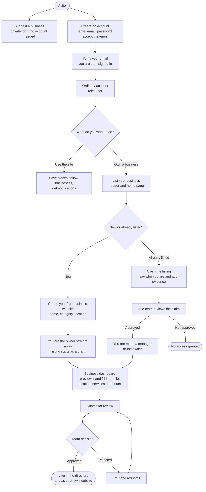

# Account and business flow

How a visitor becomes a resident, an owner or a claimant, and how a business reaches the public directory. Written on 18 November 2026 from the code on `main`, with each rule tied to where it is enforced. `src/lib/account-flow-doc.test.ts` fails if a rule below stops being true, so the chart cannot quietly go stale.

## The chart

"New or already listed?" is not a question the person is asked. The create form runs a live check against published businesses as the name is typed, and a real likeness has to be either claimed instead or confirmed as a different business before it can continue.

## Rules and where they are enforced

| Step               | Rule                                                                                                                                                                                                                                                                    | Enforced in                                                                                           |
| ------------------ | ----------------------------------------------------------------------------------------------------------------------------------------------------------------------------------------------------------------------------------------------------------------------- | ----------------------------------------------------------------------------------------------------- |
| Create an account  | Name, email, password and a ticked acceptance of the terms. Every account is stored with the role `user`.                                                                                                                                                               | `src/components/auth/register-form.tsx`, `src/lib/database/schema/auth.ts`                            |
| Verify your email  | Email verification is required, and the person is signed in once it is done.                                                                                                                                                                                            | `src/lib/auth.ts` (`requireEmailVerification`, `autoSignInAfterVerification`)                         |
| Administrator      | Never granted by sign-up. Only one private administrator exists.                                                                                                                                                                                                        | `src/lib/auth.ts` (admin role guard)                                                                  |
| Suggest a business | Open to anyone, with no sign-in.                                                                                                                                                                                                                                        | `src/app/suggest-a-business/`                                                                         |
| Create a business  | Needs a signed-in, verified, non-demonstration account; an active category and an active place; at most five owned businesses; and a likeness to a published business must be confirmed as different. The person becomes `owner` at once and the business is a `draft`. | `src/app/account/new-business/actions.ts`, `src/modules/businesses/creation.ts`                       |
| Claim a business   | Needs a signed-in, verified, non-demonstration account. Only a published business can be claimed. An account with a claim already waiting (`open`) for a business is told so instead of filing another. Evidence goes to the team.                                      | `src/app/claim/[businessId]/actions.ts`, `submitBusinessClaim` in `src/modules/businesses/tickets.ts` |
| Resolve a claim    | An administrator decides: make the claimant a manager, make them the owner, ask for more information, reject or dismiss. Nothing is granted by filing.                                                                                                                  | `resolveBusinessTicket` in `src/modules/businesses/tickets.ts`                                        |
| Submit for review  | Needs the `publish` permission on the business. Only a `draft` or `rejected` business. Profile, location, services and hours must all be complete. Done in one transaction with the business row locked.                                                                | `submitBusinessForReview` in `src/modules/businesses/publication.ts`                                  |
| While under review | The draft cannot be edited, because approval publishes whatever the draft holds at that moment.                                                                                                                                                                         | `src/modules/businesses/onboarding-draft-repository.ts`                                               |
| Approve or reject  | Administrator only (the one caller checks the administrator session first and records an audit entry). Only a business that is `pending_review`. A rejection needs a written note. Approval fails if the draft is no longer complete.                                   | `src/app/admin/businesses/[businessId]/actions.ts`, `src/modules/businesses/publication.ts`           |

## Audit, 18 November 2026

Every row above was read against the code on `main` (not only the chart's author's memory of it).

**Found and fixed in the pull request that added this page**

1. **A claim could be filed for a business that is not published.** The claim page only offers published businesses, but the action behind it accepted any business identifier, so a direct call could put a claim against someone's unpublished draft on the administrators' desk. `submitBusinessClaim` now refuses anything that is not published.
2. **No limit on repeat claims.** Report submissions are rate-limited; claims were not, so one verified account could fill the administrators' queue. An account with a claim already `open` on a business now gets "you have already sent a claim" (English and Welsh) and no second ticket. A claim the team has asked more information about (`awaiting_information`) does not count as waiting, so the claimant can still answer by submitting again.

**Checked and found correct:** the submit, approve and reject state machine; the draft lock during review; the administrator check and audit entry on approval; the owned-business limit; the duplicate check on creation; the verified-email and demonstration-account refusals on both creation and claiming.

**Accepted, not changed**

- Two claim submissions in the same instant can both be filed. The desk shows them side by side and an administrator resolves one. A database constraint would need a migration for little gain.
- The Welsh wording of the new "already sent" message is a first draft and needs the same review as the rest of the Welsh text.

**Not checked:** what the administrator desk shows when a claimant already owns the business (the code has a warning for it; its wording was not reviewed here).
